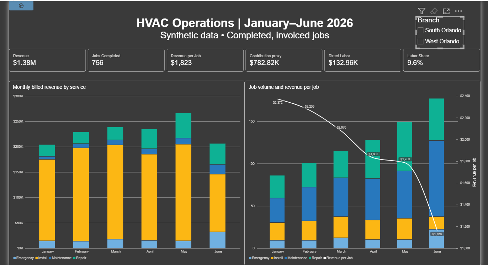
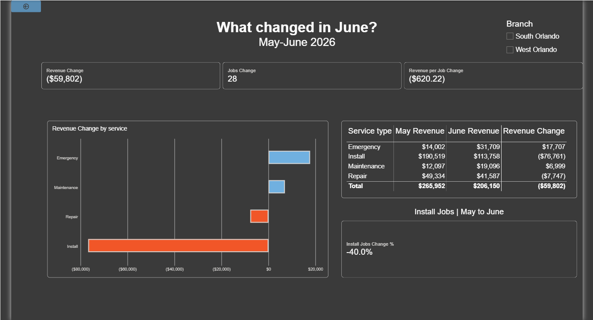

# HVAC Operations Diagnostic

**An end-to-end operations analytics case study using Python, SQL, and Power BI**

This project examines how service mix, job volume, and operating costs affect the performance of a multi-branch HVAC service business. It turns raw operational records into validated reporting tables, an interactive Power BI dashboard, and recommendations a manager could use to investigate changing performance.

> **Portfolio case study:** All business data are synthetic. The analysis illustrates a decision-support workflow, not the performance of a real HVAC company.

## Business questions

- How are completed jobs, billed revenue, and revenue per job changing over time?
- Which service types are driving changes in revenue, especially from May to June 2026?
- Are changes in average revenue per job associated with a different **mix of services** or changes **within** service types?
- Where should management investigate capacity, callbacks, and opportunities to convert repair work into installations?

## Dashboard

The Power BI report contains **two pages**:

### 1. Operations overview

An interactive summary of January–June 2026, including:

- Net-billed revenue, completed jobs, and revenue per job
- Modeled contribution, direct labor cost, and labor cost as a share of revenue
- Monthly revenue by service type
- Completed-job volume alongside revenue per job
- Branch filtering for location-level comparisons

**Screenshot — Operations Overview (default view, no filters applied):**



### 2. What changed in June? (May vs. June)

A more focused investigation of the month-to-month movement, including:

- Changes in revenue, completed jobs, and revenue per job
- Revenue change by service type
- May and June revenue comparisons by service type
- Percentage change in installation jobs
- Branch filtering to isolate different operating patterns

**Screenshot — May vs. June Diagnostic (default view, no filters applied):**



**Power BI file:** [Lakeview_HVAC_Diagnostic.pbix](dashboard/Lakeview_HVAC_Diagnostic.pbix)

## Analytical approach

**1. Data preparation and validation.** Python imports six Excel sheets—Customers, Technicians, Jobs, TimeEntries, Invoices, and MarketingSpend—into an in-memory SQLite database. The audit checks unique and required identifiers, referential integrity, completed-job rules, invoice arithmetic, and labor-hour logic.

**2. Job-level reporting layer.** A SQL query produces one row per completed and invoiced job, combining branch, service, invoice, labor, and direct-cost fields. The pipeline includes assertions for **756 unique completed jobs** and **$1,378,448 in net-billed revenue**, reconciled against source invoices.

**3. Operational aggregation.** Pandas generates monthly reporting tables by branch and service type, including job counts, revenue, contribution proxy, direct labor, paid and overtime hours, and callback rates.

**4. Change decomposition.** A Python analysis separates the change in revenue per job and callback rate into a **service-mix effect** and a **within-service effect** for consecutive months. This helps distinguish changes in *what work was performed* from changes in the outcomes of comparable work.

**5. Management reporting.** Power BI presents a concise operating overview and a specific May-to-June diagnostic, allowing findings to be explored at the branch level.

## Findings and operational implications

The synthetic scenario highlights a decline in installation activity entering June and a greater role for emergency and maintenance work in the service mix. This matters because a shift away from higher-ticket installations can reduce average revenue per job even when demand for other work is healthy.

**Recommended management actions:**

1. **Monitor service mix alongside total revenue.** Track installation volume, installation share, and revenue per job together; a topline revenue change alone does not identify its driver.
2. **Investigate repair-to-install conversion.** Identify repair customers whose equipment or service histories may justify a follow-up estimate, and measure estimate-to-install conversion before investing further.
3. **Align capacity with changing demand.** Compare paid hours, overtime, and callback rates across branches and service types to identify potential scheduling or quality constraints.
4. **Test targeted acquisition, then measure results.** Pilot installation-focused outreach in selected service areas, but add reliable campaign attribution before claiming marketing ROI.

These are **hypotheses and recommended follow-up analyses**, not proven causal effects or measured intervention results. The six-month synthetic window is too limited to establish a recurring seasonal pattern.

## Data quality and metric definitions

| Metric | Interpretation |
| --- | --- |
| **Completed jobs** | Count of completed, invoiced jobs in the job-level fact table |
| **Net-billed revenue** | Invoiced charges after discounts; not necessarily cash collected |
| **Revenue per job** | Net-billed revenue divided by completed jobs |
| **Direct labor cost** | Modeled labor cost associated with job time entries |
| **Labor share** | Direct labor cost as a percentage of net-billed revenue |
| **Contribution proxy** | Modeled direct contribution; **not** full accounting profit or net margin |
| **Callback rate** | Share of completed jobs flagged as callbacks |

The audit includes negative test cases that deliberately introduce a duplicate invoice and a blank `net_billed` field to ensure key validation rules detect errors. Missing customer acquisition channels are reported as a warning rather than treated as a complete dataset.

## Tools and skills demonstrated

**Python / pandas:** ingestion, auditing, aggregation, reconciliation, and decomposition  
**SQL / SQLite:** joins, validation queries, job-level fact construction  
**Power BI / DAX:** KPI measures, branch slicers, trend analysis, service-level comparisons  
**Operations analytics:** metric definition, root-cause investigation, business recommendations, and reporting controls

## Repository structure

```text
hvac-operations-diagnostic/
├── README.md
├── backend/
│   ├── audit_hvac_data.py
│   ├── monthly_summary.py
│   ├── sql/
│   │   └── completed_job_fact.sql
│   └── data/
│       └── Reader_Analytics_HVAC_Data_Collection.xlsx
├── dashboard/
│   └── Lakeview_HVAC_Diagnostic.pbix
├── outputs/
│   ├── completed_job_fact.csv
│   ├── monthly_branch_summary.csv
│   ├── monthly_branch_service_summary.csv
│   ├── monthly_service_type_summary.csv
│   ├── monthly_reconciliation_check.csv
│   └── monthly_service_mix_findings.csv
└── assets/
    ├── operations-overview.png
    └── may-june-diagnostic.png
```

The two dashboard screenshots must be added to `assets/` before publishing. Generated `.pyc` files and local Python environments are excluded using `.gitignore`.

## Run locally

**Requirements:** Python 3, `pandas`, `openpyxl`, the synthetic Excel workbook, and `completed_job_fact.sql`. The workbook, SQL file, and dependency manifest are included in the repository.

```bash
python -m pip install -r requirements.txt
python backend/audit_hvac_data.py
python backend/monthly_summary.py
```

The first script audits the source data and exports `outputs/completed_job_fact.csv`. The second exports monthly summaries, reconciliation results, and service-mix findings. Open the `.pbix` file in Power BI Desktop; if necessary, update its data-source path to the local CSV before refreshing.

**Reproducibility note:** The scripts currently assume this specific workbook schema, April–June 2026 comparison months, and fixed reconciliation totals. To generalize the pipeline, these assumptions should be parameterized. The SQL extraction file was reconstructed from the available source schema and validated against the original reconciliation checks; its modeled labor assumptions should be reviewed against the original report before interpreting contribution figures as exact matches.

## Limitations and next steps

- The case study uses **synthetic data** over a short time window; insights should not be generalized to the real HVAC market.
- Contribution is a modeled **direct-cost proxy**, not operating or net profit.
- Marketing spend is audited as source data, but campaign attribution and ROI analysis have **not** been implemented.
- Future additions could include a dedicated **labor-efficiency and callback-quality** report page, a tracked repair-to-install funnel, and automated regression tests for the data pipeline.

---

**Project focus:** Translating validated operational data into clear business diagnostics and actionable decisions.

- Future additions could include a dedicated **labor-efficiency and callback-quality** report page, a tracked repair-to-install funnel, and automated regression tests for the data pipeline.

---

**Project focus:** Translating validated operational data into clear business diagnostics and actionable decisions.
